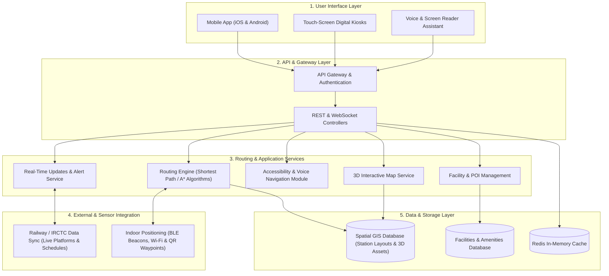
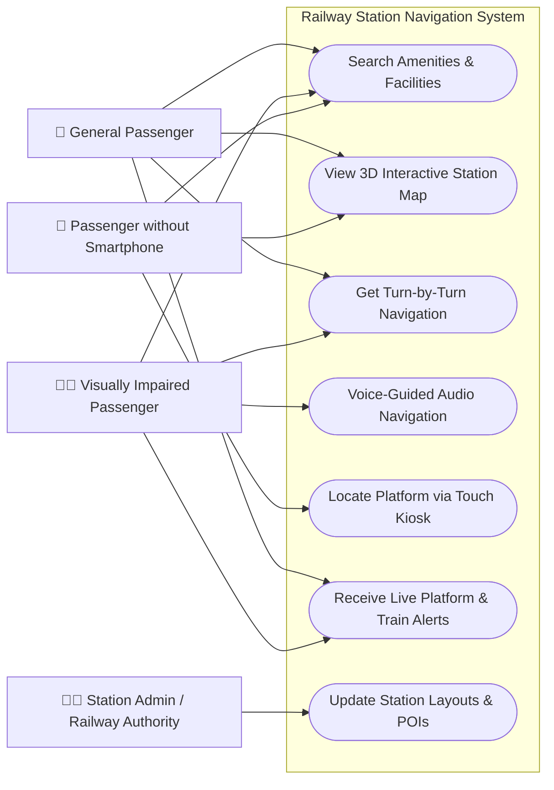

# Smart India Hackathon Workshop
# Date:26/10/2026
## Register Number:212225040111
## Name:Hariharan Ganesh
## Problem Title
SIH 1710: Enhancing Navigation for Railway Station Facilities and Locations
## Problem Description
Background: Railway stations are complex environments with numerous facilities and locations such as ticket counters, platforms, restrooms, food courts, and waiting areas. Passengers often face difficulties in navigating these spaces, especially in large or unfamiliar stations. Efficient and user-friendly navigation systems are crucial for improving passenger experience, reducing congestion, and ensuring timely travel connections. Description: The problem involves developing a comprehensive navigation solution for railway stations that assists passengers in locating various facilities and destinations within the station premises. This includes creating detailed maps, providing real-time directions, and integrating features such as accessibility options for individuals with disabilities. The solution should be intuitive, easy to use, and accessible via multiple platforms, including mobile devices and digital kiosks. Key challenges include updating navigation information in real-time, ensuring accuracy, and accommodating the diverse needs of all passengers. Expected Solution: The expected solution is a multi-platform navigation system that provides detailed, real-time directions to all facilities and locations within a railway station. This system should include: A mobile application with 3D interactive maps and step-by-step navigation. Digital kiosks located throughout the station with touch-screen interfaces. Voice-guided navigation for visually impaired passengers. Regular updates to reflect changes in station layout and facility locations. Integration with existing railway apps and services for seamless user experience. The solution should enhance the overall passenger experience by reducing confusion, saving time, and improving accessibility within the station.

## Problem Creater's Organization
Ministry of Railway

## Idea
An integrated navigation ecosystem combining a mobile application and digital kiosks to provide turn-by-turn, real-time routing inside railway stations. The system will prioritize accessibility through voice-guided instructions and visual 3D maps to reduce congestion and ensure passengers reach their platforms or amenities efficiently.

## Proposed Solution / Architecture Diagram

### System Architecture Diagram

- **User Interfaces:** A mobile app (smartphones) and touch-screen digital kiosks located throughout the station premises.
- **Routing Engine:** A cloud-based backend that calculates the shortest paths to platforms, restrooms, and food courts, delivering step-by-step navigation.
- **Accessibility Module:** A dedicated voice-guided navigation system integrated with screen readers for visually impaired passengers.
- **Data Integration Layer:** APIs connecting with existing railway services to sync real-time layout changes and passenger travel connections.

## Use Cases

### Use Case Diagram

- **Scenario 1:** A passenger arriving at a large, unfamiliar station uses the mobile app's 3D interactive map to locate the correct platform.
- **Scenario 2:** A visually impaired individual utilizes the app's voice-guided navigation to independently route from the ticket counter to a waiting area.
- **Scenario 3:** A user without a smartphone utilizes a touch-screen digital kiosk to find the nearest food court.

## Technology Stack
UI/UX Design: Figma

Frontend / Mobile: React Native or Flutter (for cross-platform deployment)

Backend: Python (FastAPI/Django) or Node.js

Mapping & Geolocation: Mapbox API or Google Maps SDK for 3D maps

Accessibility: Native Text-to-Speech (TTS) and Voice Recognition APIs

## Dependencies
Mapping and indoor geolocation API keys.

Access to the Ministry of Railway's station layout data and real-time transit updates.

Cloud hosting infrastructure for the backend database.
